# Mesen 学习机版

*A fork of [MesenCE](https://github.com/nesdev-org/MesenCE) that adds the Chinese learning machines of the 1990s (BBK, Subor SB-2000 / SB97, YuXing, Kingwon / Bung Doctor PC Jr., LingTong / Zoson VCD) and the Super A'Can console.*

本项目基于 Mesen 社区版（MesenCE），加入了九十年代国产电脑学习机的模拟：步步高、小霸王 SB-2000 / SB97、裕兴、科王 / 邦谷小博士、灵童 / 中索 VCD，以及 Super A'Can 游戏机。Mesen 原有的功能全部保留：调试器、即时存档、倒带、录像、着色器等等。

## 下载

最新版本在 [Releases 页面](https://github.com/Tsubasa2007/MesenCE/releases)。下载 `Mesen-bbk-日期-win-x64.zip`，解压到一个单独的文件夹，运行 `Mesen.exe` 即可，不需要另外安装 .NET。

BIOS、软盘和光盘镜像都**不**随本程序提供，请使用自己的备份。

## 支持的机器

| 机器 | 需要的文件 | 模拟的硬件 |
|---|---|---|
| 步步高软驱一号（1.0）、步步高 98 型（电子盘） | BIOS（.nes）＋ 软盘镜像（.img） | 软驱、键盘、鼠标、真人语音、打印机 |
| 步步高语音二号 | BIOS（.nes） | 键盘、语音，可接打印机 |
| 小霸王 SB-2000 | BIOS（.nes）＋ 软盘镜像（.img / .ima） | UM6576 显示芯片、软驱、键盘、鼠标、语音 |
| 小霸王 SB97 | V5.0 卡带的 BIOS（.nes）＋ 软盘镜像（.img / .ima） | 软驱（卡带上的 SB DOS）、键盘、语音、打印机 |
| 裕兴电脑学习机（软驱型、VCD 型） | BIOS（.nes）＋ 软盘镜像（.img），VCD 型还可以用光盘镜像（.cue / .bin / .iso） | 软驱、VCD 光驱与光盘菜单、VCD 画面与声音、键盘、内置鼠标或 D 型串口鼠标、打印机 |
| 科王 KW2000 / KW3000、邦谷小博士（Bung Doctor PC Jr.） | BIOS（.nes）＋ 光盘镜像（.cue / .bin），也可以用软盘镜像（.img） | 光驱、软驱、VCD 画面、键盘、鼠标、打印机 |
| 灵童 SMART-128B（含电子盘版）、中索 VCD（G2002） | BIOS（.nes）＋ 软盘镜像（.woz）；中索 VCD 用光盘镜像（.cue / .bin / .iso），光盘上的游戏（.cdv）也可以直接打开 | 软驱、电子盘、光驱与光盘菜单、键盘、鼠标、语音、打印机 |
| 小霸王中英文电脑学习卡 | 卡带（.nes） | 键盘、鼠标、语音 |
| 裕兴电脑学习卡 | 卡带（.nes） | 键盘、鼠标 |
| Super A'Can | 卡带（.bin，或两片芯片合在一起的 .zip） | 整机，另有 68000 与声音处理器的调试器 |

## 运行截图

每种机器先显示前几张，点「更多」展开其余的。

### 步步高：语音二号、软驱一号（1.0）、98 型

<table>
<tr><td align="center">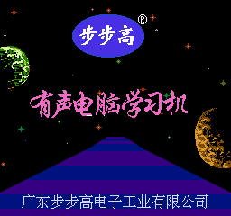 语音二号：开机画面</td><td align="center">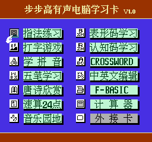 语音二号：学习卡菜单</td><td align="center">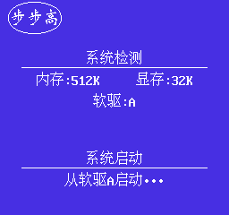 软驱一号：开机自检</td><td align="center">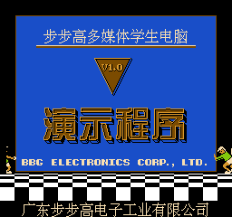 步步高 DEMO 演示系统</td></tr>
</table>

更多（26 张）

<table>
<tr><td align="center">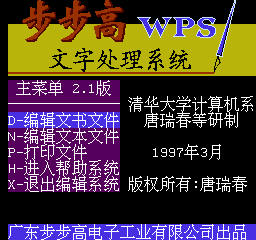 002 步步高 WPS 文字处理系统 2.1</td><td align="center">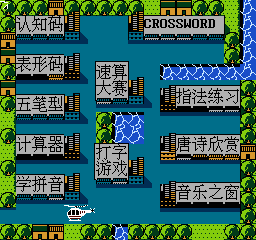 003 打字游戏</td><td align="center">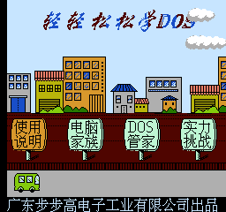 004 轻轻松松学 DOS</td><td align="center"> 005 步步高英语（入门篇）</td></tr>
<tr><td align="center">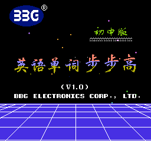 006 英语单词步步高（初中版）</td><td align="center">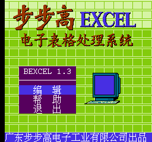 007 步步高电子表格</td><td align="center">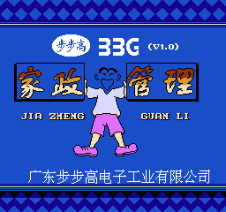 009 步步高家政管理</td><td align="center">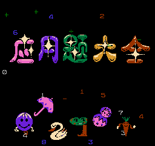 010 应用题大全</td></tr>
<tr><td align="center">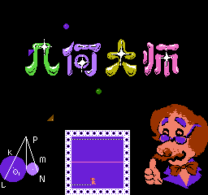 011 几何大师</td><td align="center">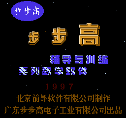 016 初中语文辅导与训练</td><td align="center"> 119 智力训练 365</td><td align="center">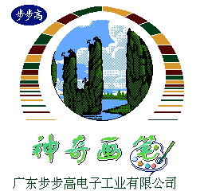 122 神奇画笔</td></tr>
<tr><td align="center">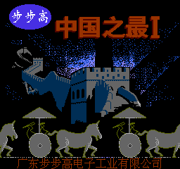 126 中国之最（一）</td><td align="center">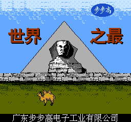 128 世界之最</td><td align="center">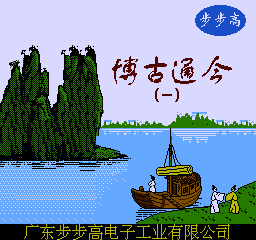 129 博古通今（一）</td><td align="center">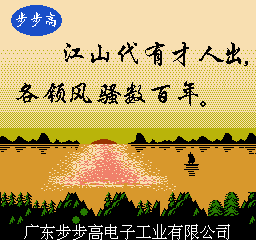 132 数风流人物</td></tr>
<tr><td align="center">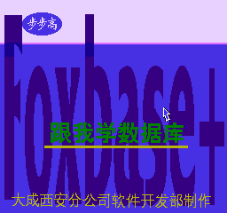 190 跟我学数据库</td><td align="center">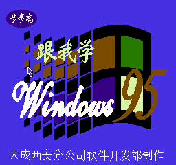 193 跟我学 Windows 95</td><td align="center">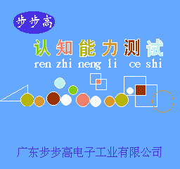 196 认知能力训练</td><td align="center">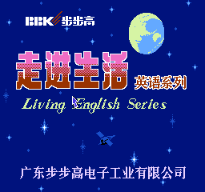 277 走进生活英语系列·学校英语</td></tr>
<tr><td align="center">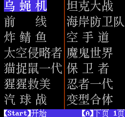 GT001 游戏合集</td><td align="center">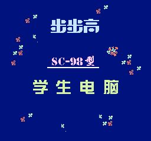 98 型：开机画面</td><td align="center">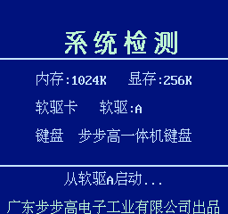 98 型：开机自检</td><td align="center">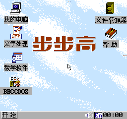 98 型：桌面</td></tr>
<tr><td align="center">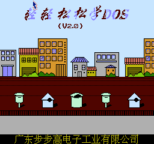 98 型专用软件 T002 轻轻松松学 DOS 2.0</td><td align="center">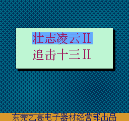 GT301 壮志凌云 II / 追击十三 II</td></tr>
</table>

### 小霸王 SB-2000

<table>
<tr><td align="center">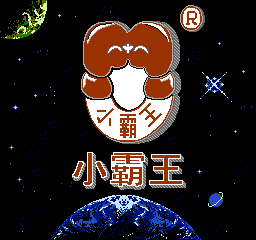 开机画面</td><td align="center">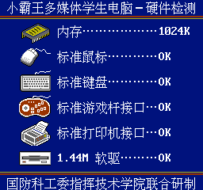 硬件检测</td><td align="center">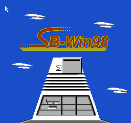 001 系统演示 DEMO</td><td align="center">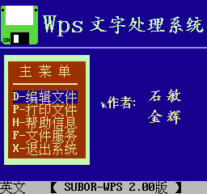 002 WPS 文字处理</td></tr>
</table>

更多（16 张）

<table>
<tr><td align="center">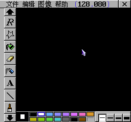 003 神奇画笔</td><td align="center">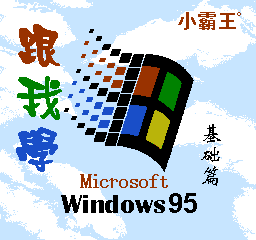 005 跟我学 Windows 95 之一：基础篇</td><td align="center">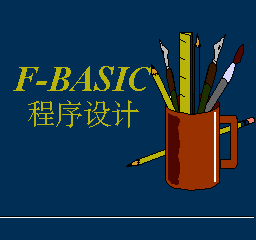 014 F-BASIC 程序设计</td><td align="center">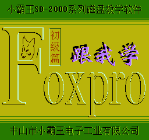 015 跟我学 FoxPro 之一：基础篇</td></tr>
<tr><td align="center">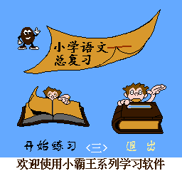 041 小学语文毕业总复习（三）</td><td align="center">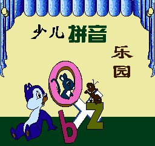 253 少儿拼音乐园</td><td align="center">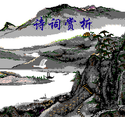 262 诗词鉴赏</td><td align="center">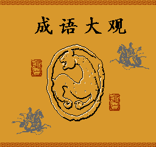 275 成语故事</td></tr>
<tr><td align="center"> 305 英语语音入门</td><td align="center">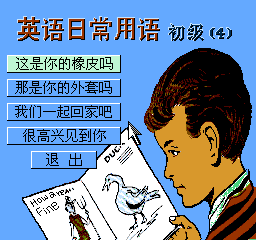 349 英语日常用语·初级篇之四</td><td align="center"> 371 少儿英语图解字典</td><td align="center">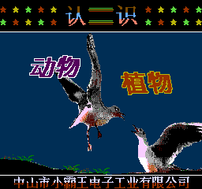 382 认识植物（1）</td></tr>
<tr><td align="center">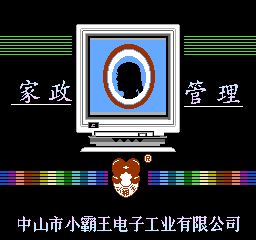 391 家政管理</td><td align="center">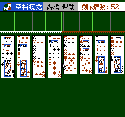 399 空挡接龙</td><td align="center">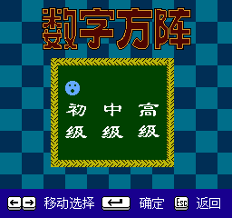 401 数字方阵</td><td align="center">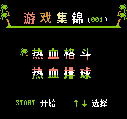 G001 热血格斗 + 热血排球</td></tr>
</table>

### 小霸王 SB97

<table>
<tr><td align="center">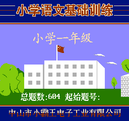 A10 小学语文基础训练一年级</td><td align="center"> B751 初中代数二年级（上）</td><td align="center">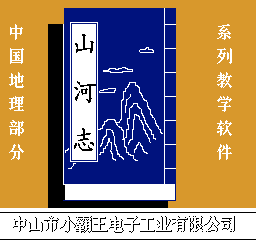 G71 中国地理</td><td align="center">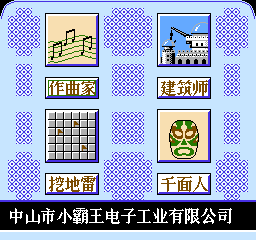 V01 智力训练（一）</td></tr>
</table>

更多（3 张）

<table>
<tr><td align="center">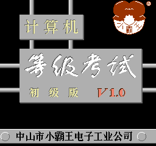 X71 计算机等级考试（初级版）基础知识 DOS 教学</td><td align="center"> X91 WPS</td><td align="center"> X92 BASIC</td></tr>
</table>

### 裕兴 VCD 型

<table>
<tr><td align="center"> 开机画面</td><td align="center"> 主菜单</td><td align="center"> 2B02 WPS 五笔打字集锦</td><td align="center"> GAM01 游戏系列①</td></tr>
</table>

更多（12 张）

<table>
<tr><td align="center"> GAM02 游戏系列②</td><td align="center"> GAM03 游戏系列③</td><td align="center"> JSJ-01 电脑大师① PC 机组装与使用</td><td align="center"> JSJ-02 电脑大师② 打字、五笔字型</td></tr>
<tr><td align="center"> JSJ-03 电脑大师③ Windows 98（A）</td><td align="center"> JSJ-03 电脑大师③ Windows 98（B）</td><td align="center"> JSJ-04 电脑大师④ WPS2000</td><td align="center"> T03 315L 驱动光盘</td></tr>
<tr><td align="center"> YPD-01 小学系列</td><td align="center"> YPD-02 中学系列</td><td align="center"> YXF-02 英语启明星</td><td align="center"> YXF-02 英语启明星：课程</td></tr>
</table>

### 科王 KW3000（VCD）

<table>
<tr><td align="center"> 开机画面</td><td align="center"> VCD 播放器</td><td align="center"> 游戏大全（一）</td><td align="center"> 游戏大全（二）</td></tr>
</table>

更多（9 张）

<table>
<tr><td align="center"> 游戏大全（三）</td><td align="center"> 游戏大全（四）</td><td align="center"> 游戏大全（五）</td><td align="center"> Wins98 视窗教学专辑：桌面</td></tr>
<tr><td align="center"> Wins98 视窗教学专辑：少儿百科</td><td align="center"> 科王十万个为什么</td><td align="center"> 开口就说英语入门</td><td align="center"> 神奇的电和时间</td></tr>
<tr><td align="center"> 科王电脑 VCD 标准化试题集</td></tr>
</table>

### 中索 VCD

<table>
<tr><td align="center"> STARDVCD01：文字处理、数据库</td><td align="center"> STARCVCD02：打字学校、英语词霸</td><td align="center"> STARCVCD03：益智游戏、电子琴、音乐欣赏</td><td align="center"> STARCVCD04：游戏菜单</td></tr>
</table>

### 小霸王中英文电脑学习卡

<table>
<tr><td align="center"> V1.0 标题</td><td align="center"> V1.0 菜单</td><td align="center"> V1.1 菜单</td><td align="center"> V3.0 标题</td></tr>
</table>

更多（26 张）

<table>
<tr><td align="center"> V3.0 菜单</td><td align="center"> V4.0 标题</td><td align="center"> V4.0 菜单</td><td align="center"> V5.0 标题</td></tr>
<tr><td align="center"> V5.0 菜单</td><td align="center"> V6.0 标题</td><td align="center"> V6.0 菜单</td><td align="center"> V6.0+ 标题</td></tr>
<tr><td align="center"> V6.0+ 菜单</td><td align="center"> V7.0 标题</td><td align="center"> V7.0 菜单</td><td align="center"> V8.0 标题</td></tr>
<tr><td align="center"> V8.0 菜单</td><td align="center"> V9.0 标题</td><td align="center"> V9.0 菜单</td><td align="center"> V9.1 菜单</td></tr>
<tr><td align="center"> V11.0 标题</td><td align="center"> V11.0 菜单</td><td align="center"> V12.0 开机画面</td><td align="center"> V12.0 桌面</td></tr>
<tr><td align="center"> V13.0 桌面</td><td align="center"> V14.0 开机画面</td><td align="center"> V14.0 桌面</td><td align="center"> V15.0 开机画面（Windows 2002）</td></tr>
<tr><td align="center"> V15.0 桌面</td><td align="center"> V15.0 另一版本开机画面（Windows 2005）</td></tr>
</table>

### 裕兴电脑学习机（软驱型）、裕兴电脑学习卡

<table>
<tr><td align="center"> V4.0 BASIC</td><td align="center"> V5.0 标题</td><td align="center"> V7.0 标题</td><td align="center"> V7.0 菜单</td></tr>
</table>

更多（14 张）

<table>
<tr><td align="center"> V8.0-C 标题</td><td align="center"> V8.0-C 菜单</td><td align="center"> V8.2-D 标题</td><td align="center"> V8.2-D 菜单</td></tr>
<tr><td align="center"> V8.3-D 标题</td><td align="center"> V8.3-D 菜单</td><td align="center"> V9.0-98 标题</td><td align="center"> V9.2-F 标题</td></tr>
<tr><td align="center"> V9.2-F 菜单</td><td align="center"> V10 标题</td><td align="center"> V10 桌面</td><td align="center"> V11 桌面</td></tr>
<tr><td align="center"> 超级学习机 1 号 标题</td><td align="center"> 超级学习机 1 号 桌面</td></tr>
</table>

## 快速上手

### 1. 放好 BIOS

把学习机的 BIOS（.nes 文件）放到 `Mesen.exe` 所在的文件夹。

### 2. 步步高、小霸王 SB-2000：直接打开软盘镜像

用 **File → Open** 打开软盘镜像（.img / .ima），也可以把镜像拖进窗口。Mesen 会从软盘本身判断它是步步高的盘还是 SB-2000 的盘，再用 `Mesen.exe` 旁边对应的 BIOS 开机。文件夹里同时有步步高 1.0 和 98 型的 BIOS 时，优先用 1.0，因为大部分软件是为 1.0 写的。

另一种方式：把 BIOS 复制一份，改成和镜像相同的文件名放在一起，例如 `游戏.nes` 和 `游戏.img`，然后打开这个 `.nes`，同名的镜像会自动插入。

### 3. 小霸王 SB97、裕兴、科王、邦谷、灵童、中索：先开机，再放盘

打开 BIOS 的 `.nes` 文件。和 BIOS 同名的软盘镜像（`.img`，灵童是 `.woz`）或光盘镜像（`.cue`，或 `.bin` / `.iso`）会自动放进驱动器，也可以开机后再选。

### 4. 换盘

**Game → Select Disk** 会列出文件夹中的镜像，可以搜索、插入（Insert）、弹出（Eject），用 **Change Folder...** 换到存放镜像的文件夹。**Game → Eject Disk** 直接弹出。软盘和光盘都在这里换。

### 5. 键盘和鼠标

- 载入学习机后，Mesen 会自动接上这台机器的键盘和鼠标（**Settings → NES → Input** 里的 *Automatically configure controllers when loading a game*，默认开启）。
- 接上键盘后，Mesen 的快捷键会停用，按键交给学习机。**只有「暂停」（Pause）例外**，但它的默认键 Esc 在接上键盘时只交给学习机，不会暂停。要暂停可以用菜单，或者在 **Settings → Preferences → Shortcut Keys** 里给 Pause 设一个不含 Esc 的键。
- 在画面上单击即可捕获鼠标。按一下 Alt 键（会切到 Mesen 的菜单栏），或者切换到别的窗口（例如 Alt+Tab），就会释放鼠标。

### 6. 光盘里的视频

裕兴和科王光盘上的 VCD 视频直接在机器画面上播放，画面下方有播放条，可以暂停、拖动、跳过。倒带和读取即时存档时，视频会回到机器当时的位置。**Settings → NES → General → Video CD Settings** 可以改用外部播放器播放，或者跳过视频。

### 7. 打印机

学习机打印出来的内容以 PNG 图片保存在 Mesen 的 `Screenshots` 文件夹里。

### 8. 其他设置

在 **Settings → NES → General** 里：

- *BBK Learning Machine Settings*：屏幕右上角的磁盘指示灯；语音二号接打印机。
- *YuXing Learning Machine Settings*：光驱里没有光盘时跳过 VCD 播放画面；改用 D 型串口鼠标。

### 注意

- 程序写盘时，内容会直接写进软盘镜像文件。
- **即时存档会连同整张软盘一起保存。读取存档时，软盘镜像会被改回存档那一刻的内容。** 请先备份重要的镜像。

## 在 Mesen 上新增的主要功能

- **学习机的硬件模拟**
  - 步步高：Inno / Holtek 两颗 ASIC 的内存与显示分页、分屏、行计数中断、LPC-10 真人语音、uPD765 软驱控制器、ESC/P 针式打印机，98 型的 2MB 电子盘。
  - 小霸王 SB-2000：UM6576 显示芯片（块传输 DMA、扩展的图块模式）、软驱、语音。
  - 裕兴：软驱、VCD 光驱与光盘菜单（按菜单项所指的程序启动）、MMC3 兼容芯片与转换的卡带游戏、XT 键盘、串口鼠标、313 行的画面时序。
  - 科王 / 邦谷：兼容 PPU、310 行的画面时序、光驱与光盘载入程序、软驱、光盘游戏的 MMC2 等芯片、键盘与鼠标、打印机。
  - 小霸王 SB97：V5.0 卡带上的 SB DOS、uPD765 软驱控制器、256KB 程序内存、语音、打印机。
  - 灵童 / 中索：Apple II 式软驱（WOZ 镜像）、电子盘、1MB / 2MB 内存、TMS5220 型语音、中索 VCD 的光驱与光盘载入程序、打印机。
- **VCD 视频解码**：光盘上的 MPEG-1 画面和 MP2 声音在机器自己的画面上播放，带播放条，与即时存档和倒带同步。
- **换盘窗口**：可搜索的软盘 / 光盘列表，插入、弹出、更换文件夹。
- **Super A'Can 游戏机**：整机模拟、手柄设置（**Settings → Other systems → Super A'Can**）、68000 调试器与声音处理器调试器。
- **HD 包**：修正了 HD 包制作器会丢失 CHR RAM 图块的问题，以及 HD 包制作器和渲染器会读到错误精灵指针而崩溃的问题。
- **其他**：没有音频设备时（例如关闭了声音的远程桌面）静音启动而不是崩溃；像素较窄的机器在分辨率变化后保持所选的窗口倍数。

## 致谢

感谢 Mesen 的原作者 Sour，以及维护 MesenCE 的社区。

本项目的学习机模拟建立在前辈们多年的研究之上，没有他们就没有这个项目：

- **钳工（fanoble）**：步步高软驱一号、小霸王 SB-2000、普里奇与奇老师声像卡的模拟器（VirtuaNES 修改版，源代码见 <https://gitee.com/fanoble/emulator-bbk>）。本项目的步步高、SB-2000 模拟，以及语音、软驱、打印机，都是从这份代码移植过来的。
- **惊风**：在钳工的模拟器基础上做的 VirtuaNES 修改版 EX 系列，完善了裕兴、小霸王的模拟，加入了步步高 98 型、邦谷小 PC、科王 2000 / 3000、裕兴 VCD、中索 VCD、灵童等机器的支持，并 dump、发布了大量学习卡 ROM。本项目的裕兴、科王 / 邦谷与步步高 98 型的模拟，是从这个版本的代码移植过来的。
- **NewRisingSun**：NintendulatorNRS 模拟器的作者。本项目中 PC 规格软驱控制器（裕兴、科王 / 邦谷使用）的模拟代码出自他手，科王 / 邦谷与步步高 98 型的模拟最早也源自 NintendulatorNRS。
- **STAR**：修改版 FCEUX 中的裕兴 bin 文件支持，以及和钳工一起破解裕兴的语音数据。
- 为钳工的模拟器提供帮助和资料的朋友：**BaNuI**（SB2000 ROM 与电路）、**轻舞**（软驱一号 ROM）、**重庆仔**（奇老师 ROM）、**汤圆**（奇老师原机器、声像磁带录音）、**天の邪鬼**（普里奇 PAL），以及 **VB步步高**、**花生壳**。
- 为学习机和学习卡 ROM 的 dump 与保存出力的 **TPU**、**maxzhou88（周哥）**，以及 **nesbbs** 论坛。
- 以及所有保存、dump、分享这些机器和软件资料的朋友们。

## 编译

见 [COMPILING.md](COMPILING.md)。

## 许可证

Mesen 以 GPL V3 许可证发布，全文见 <http://www.gnu.org/licenses/gpl-3.0.en.html>。

Copyright (C) 2014-2026 Sour, 2026 contributors

This program is free software: you can redistribute it and/or modify
it under the terms of the GNU General Public License as published by
the Free Software Foundation, either version 3 of the License, or
(at your option) any later version.

This program is distributed in the hope that it will be useful,
but WITHOUT ANY WARRANTY; without even the implied warranty of
MERCHANTABILITY or FITNESS FOR A PARTICULAR PURPOSE.  See the
GNU General Public License for more details.

You should have received a copy of the GNU General Public License
along with this program.  If not, see <http://www.gnu.org/licenses/>.
